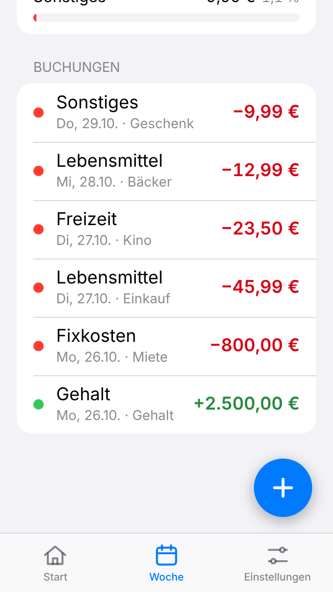

# Finanzen – persönliche Haushalts-App

Kleine Web-App (PWA) für Einnahmen und Ausgaben. Läuft komplett im Browser, die Daten bleiben auf dem Gerät – kein Server, kein Login.

<p>
  
  
</p>

## Funktionen (Version 1)

- **Kontostand**: Startguthaben + Einnahmen − Ausgaben, groß auf der Startseite.
- **Buchungen**: Einnahme/Ausgabe, Betrag, Datum, Kategorie, Notiz – bearbeiten und löschen per Tippen auf die Buchung.
- **Kategorien**: Standard-Kategorien plus eigene (hinzufügen, umbenennen, löschen). Buchungen gelöschter Kategorien wandern nach „Sonstiges“.
- **Wochenübersicht** (Mo–So): Einnahmen, Ausgaben, Saldo, Ausgaben pro Kategorie mit Prozent und Balken, alle Buchungen der Woche.
- **Backup**: Export/Import aller Daten als JSON (Einstellungen → Datensicherung).
- **Offline-fähig** und als App auf dem Home-Bildschirm installierbar.

## Starten

Voraussetzung: [Node.js](https://nodejs.org) 20 oder neuer.

```bash
npm install
npm run dev        # Entwicklungsserver auf http://localhost:5173
npm test           # Unit-Tests (Geldformat, Wochen, Kontostand, Backup)
npm run build      # Produktions-Build nach dist/
npm run preview    # Build lokal ansehen auf http://localhost:4173
npm run e2e        # Durchklick-Test (braucht laufendes `npm run preview` und Playwright)
```

## Online stellen (GitHub Pages, kostenlos)

1. Auf GitHub im Repository: **Settings → Pages → Source: „GitHub Actions“** wählen.
2. Jeder Push auf `main` baut und veröffentlicht die App automatisch (Workflow `.github/workflows/deploy.yml`).
3. Die Adresse lautet `https://<github-name>.github.io/finanz-app/`.

## Auf dem iPhone installieren

1. Die Adresse in **Safari** öffnen.
2. Teilen-Symbol → **„Zum Home-Bildschirm“** → Hinzufügen.
3. Die App startet dann im Vollbild mit eigenem Icon und funktioniert auch offline.

**Wichtig:** Die Daten liegen nur im Speicher dieser App auf dem Gerät. Regelmäßig unter Einstellungen → Datensicherung exportieren (z. B. in iCloud Drive), besonders vor dem Löschen der App.

## Technik

React + Vite + TypeScript, `vite-plugin-pwa` (Manifest, Service Worker). Beträge werden intern als ganze Cent gespeichert. Der Datenzugriff ist hinter dem Interface `FinanceRepository` (`src/data/repository.ts`) gekapselt – heute `localStorage`, später austauschbar gegen IndexedDB oder eine Datenbank mit Sync. Details für Entwickler: [CLAUDE.md](CLAUDE.md).

## Nächste Ausbaustufen

1. **Wiederkehrende Fixkosten** (Miete, Abos) – monatlich automatisch buchen.
2. **Budgets pro Kategorie** mit Fortschrittsbalken und Warnung bei Überschreitung.
3. **Monatsauswertung** mit Vergleich zum Vormonat.
4. **Sparziele** mit Zielbetrag und Datum.
5. **Sync zwischen Handy und PC** – neues Repository-Backend (z. B. Supabase oder PocketBase), Login optional.
6. Kleinere Ideen: Suche/Filter, CSV-Export, Haptik/Swipe-to-delete.
