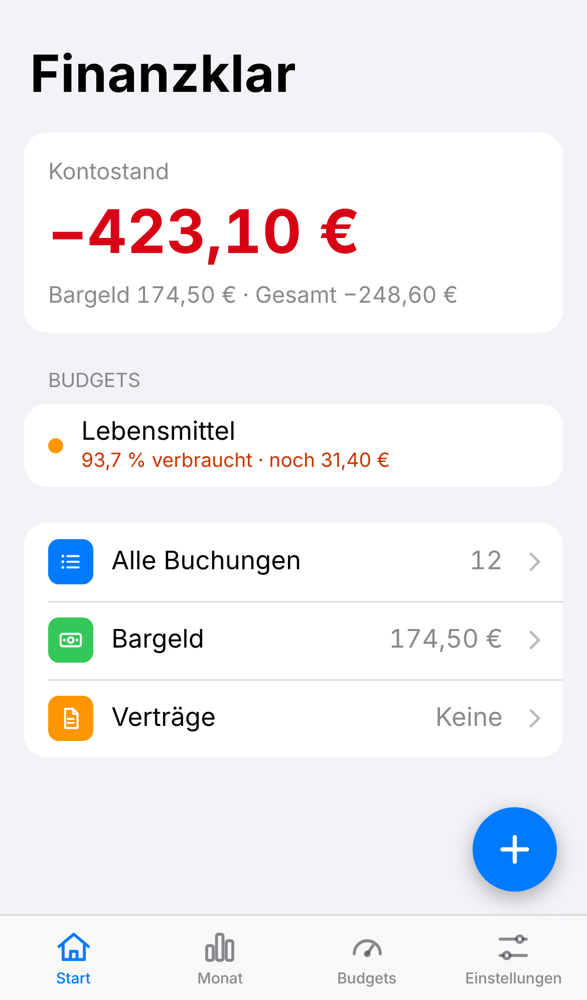
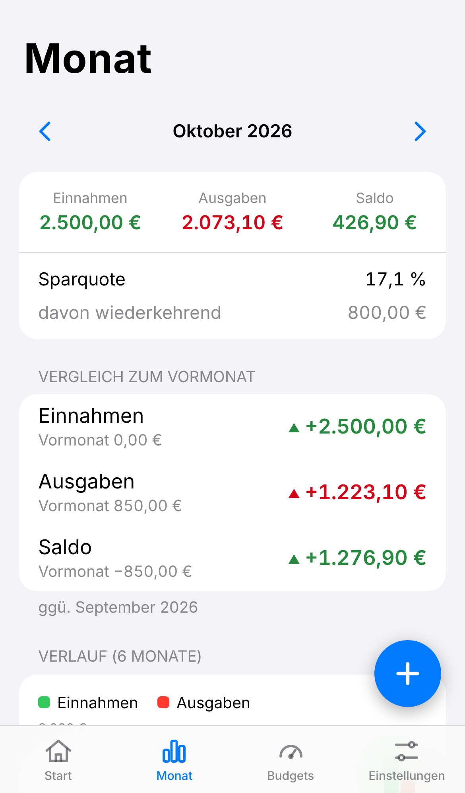

# Finanzklar – persönliche Haushalts-App

Kleine Web-App (PWA) für Einnahmen und Ausgaben. Läuft komplett im Browser, die Daten bleiben auf dem Gerät – kein Server, kein Login.

<p>
  
  
</p>

## Funktionen

- **Start-Übersicht**: Kontostand groß, darunter Bargeld und Gesamt; Zeilen zu „Alle Buchungen“ (gruppiert nach Monat, mit Suche), „Bargeld“ und „Verträge“.
- **Bargeld**: eigener Bestand mit „Bar bezahlt“, „Bar erhalten“, Abhebung (Konto → Bargeld) und Einzahlung aufs Konto. Umbuchungen zählen nicht als Einnahme oder Ausgabe.
- **Buchungen**: Einnahme/Ausgabe, Betrag, Datum, Kategorie, Notiz – bearbeiten und löschen per Tippen auf die Buchung.
- **Kategorien**: Standard-Kategorien plus eigene (hinzufügen, umbenennen, löschen). Buchungen gelöschter Kategorien wandern nach „Sonstiges“.
- **Verträge**: Miete, Abos, Gehalt (monatlich, vierteljährlich, jährlich) werden automatisch gebucht (oder, mit ausgeschaltetem „Automatisch buchen“, zur Bestätigung auf der Startseite angezeigt: Betrag und Datum anpassbar, Überspringen, „Jetzt buchen“ für früh eintreffendes Gehalt), mit optionalem Nachbuchen vergangener Termine, „Fixkosten pro Monat“ und „Demnächst fällig“ auf der Startseite (ohne Gehalt).
- **Monatsbudgets**: pro Ausgaben-Kategorie ein Budget festlegen (Tab „Budgets“), Fortschrittsbalken grün/orange/rot, Gesamtbudget, Monatsnavigation und Hinweis auf der Startseite ab 80 % Verbrauch.
- **Monatsauswertung** (Tab „Monat“): Einnahmen, Ausgaben, Saldo, Sparquote, Vergleich zum Vormonat, 6-Monats-Verlauf als Diagramm mit Tabelle, Ausgaben/Einnahmen nach Kategorie die größten Ausgaben und alle Buchungen des Monats (neueste zuerst, Tippen zum Bearbeiten, „+“ zum Hinzufügen).
- **Gesten wie auf dem iPhone**: vom linken Rand wischen = zurück (Alle Buchungen, Bargeld, Verträge), Sheets am Griff nach unten wegwischen, auf „Monat“ und „Budgets“ nach links/rechts wischen = nächster/vorheriger Monat; weiche Übergänge beim Öffnen und Schließen (nach dem Loslassen läuft die Bewegung mit dem Tempo des Fingers weiter, Tippen zeigt sofort eine Rückmeldung). Mit „Bewegung reduzieren“ im System gibt es nur kurze Überblendungen.
- **Wischen zum Löschen**: In den Buchungslisten (Alle Buchungen, Bargeld, Monat) eine Zeile nach links ziehen, bis „Löschen“ erscheint – oder ganz durchziehen, um sofort zu löschen. Danach bleibt 5 Sekunden „Rückgängig“ unten im Bild. Auch das Löschen im Bearbeiten-Fenster lässt sich so zurücknehmen.
- **Leichte Haptik**: kurzes Vibrieren/Tippen beim Speichern, Löschen und Rückgängig (Android; auf dem iPhone ab iOS 18, sonst stumm).
- **Darstellung**: Automatisch (folgt dem iPhone), Hell oder Dunkel – Einstellungen → Darstellung, gilt sofort und wird nur auf diesem Gerät gemerkt (nicht in der Sicherung).
- **Backup**: Export/Import aller Daten als JSON (Einstellungen → Datensicherung). Der Export ist standardmäßig mit Passwort verschlüsselt (AES-GCM-256, Schlüssel per PBKDF2-SHA-256 mit 600 000 Runden, nur Web Crypto des Browsers); ohne das Passwort lässt sich die Datei nicht wiederherstellen, es wird nirgends gespeichert. Unverschlüsselt exportieren geht nach einer Warnung; ältere Klartext-Backups lassen sich weiter importieren.
- **App-Sperre** (optional): Einstellungen → App-Sperre. Dann liegen alle Daten nur noch verschlüsselt auf dem Gerät (AES-GCM-256, nur Web Crypto des Browsers) und Finanzklar fragt beim Öffnen nach Passwort, Wiederherstellungsschlüssel oder Face ID (Passkey, ab iOS 18). Sperrt sich nach 1 Minute Nichtbenutzung selbst (Sofort/1/5/15 Minuten wählbar), zeigt im App-Umschalter keine Beträge und begrüßt dich nach Face ID 2,5 Sekunden lang mit „Moin, <Name>“ (Name unter Einstellungen → Persönlich; Antippen beendet die Begrüßung sofort). Passwort **und** Wiederherstellungsschlüssel zu verlieren heißt: Daten weg – darum vorher ein verschlüsseltes Backup exportieren.
- **Offline-fähig** und als App auf dem Home-Bildschirm installierbar.

## Starten

Voraussetzung: [Node.js](https://nodejs.org) 20 oder neuer.

```bash
npm install
npm run dev        # Entwicklungsserver auf http://localhost:5173
npm test           # Unit-Tests (Geldformat, Datum, Kontostand, Monat, Backup, Verschlüsselung, App-Sperre)
npm run build      # Produktions-Build nach dist/
npm run preview    # Build lokal ansehen auf http://localhost:4173
npm run e2e        # Durchklick-Test (braucht laufendes `npm run preview` und Playwright)
node e2e/perf.mjs  # Frame-/Tipp-Messung der Gesten mit gedrosselter CPU (braucht `npm run preview`, siehe CLAUDE.md)
```

## Online stellen (GitHub Pages, kostenlos)

1. Auf GitHub im Repository: **Settings → Pages → Source: „GitHub Actions“** wählen.
2. Jeder Push auf `main` baut und veröffentlicht die App automatisch (Workflow `.github/workflows/deploy.yml`).
3. Die Adresse lautet `https://<github-name>.github.io/finanz-app/`.

## Auf dem iPhone installieren

1. Die Adresse in **Safari** öffnen.
2. Teilen-Symbol → **„Zum Home-Bildschirm“** → Hinzufügen.
3. Die App startet dann im Vollbild mit eigenem Icon und funktioniert auch offline.

**Wichtig:** Die Daten liegen nur im Speicher dieser App auf dem Gerät. Regelmäßig unter Einstellungen → Datensicherung exportieren (z. B. in iCloud Drive), besonders vor dem Löschen der App.

## Technik

React + Vite + TypeScript, `vite-plugin-pwa` (Manifest, Service Worker). Beträge werden intern als ganze Cent gespeichert. Der Datenzugriff ist hinter dem Interface `FinanceRepository` (`src/data/repository.ts`) gekapselt – heute `localStorage`, später austauschbar gegen IndexedDB oder eine Datenbank mit Sync. Details für Entwickler: [CLAUDE.md](CLAUDE.md).

## Nächste Ausbaustufen

1. **Investitionen – Depot-Übersicht**: Positionen von Hand eintragen (z. B. ETF, Stückzahl, Kaufkurs), aktuellen Kurs nachtragen, Wert und Gewinn/Verlust anzeigen.
2. **Investitionen – Sparpläne**: als Vertrag, der monatlich vom Konto ins Depot geht und – wie eine Bargeld-Abhebung – nicht als Ausgabe zählt.
3. **Sparziele** mit Zielbetrag und Datum.
4. **Sync zwischen Handy und PC** – neues Repository-Backend (z. B. Supabase oder PocketBase), Login optional.
5. Kleinere Ideen: CSV-Export, Haptik/Swipe-to-delete, Suchleiste in den Einstellungen (sobald es deutlich mehr Einstellungen gibt).
